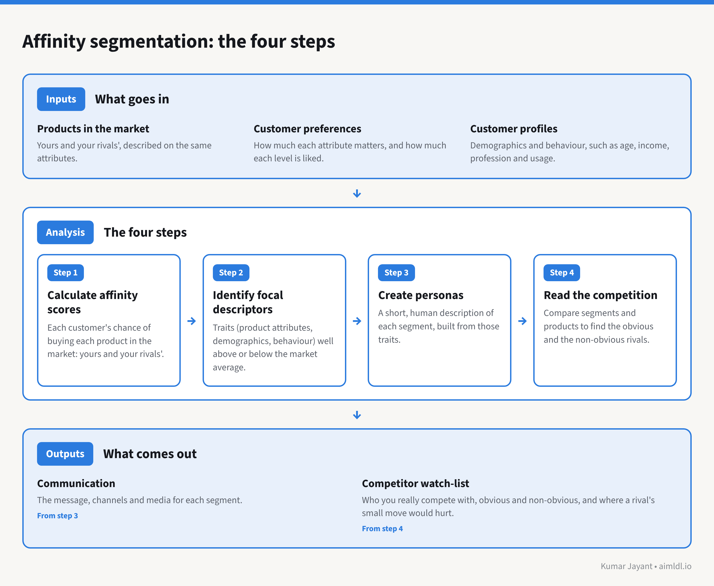
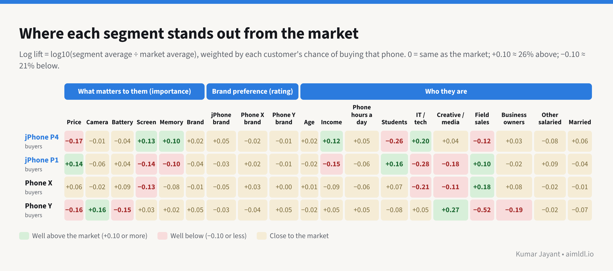
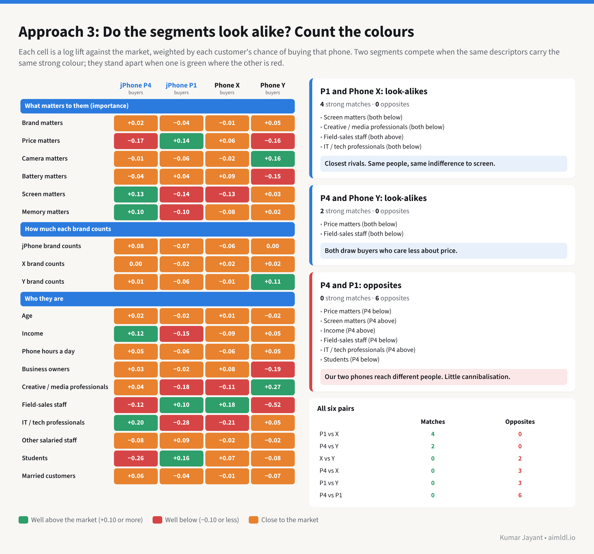

# Customer segments are not isolated islands; they are continuum of probabilities

**Affinity segmentation for targeting, positioning and competitive threat analysis.** Companion code and data for the aimldl.io post.

**Blog:** [Customer segments are not isolated islands; they are continuum of probabilities](BLOG_LINK_AFTER_PUBLISHING)  
**Dataset on Kaggle:** [jPhone: Customer Affinity Segmentation](https://www.kaggle.com/datasets/krjynt/jphone-customer-affinity-segmentation)  
**Previous post:** [Drive Out Subjectivity, Build What Customers Value](https://aimldl.io/2026/11/17/drive-out-subjectivity-build-what-customers-value/) · [code](../new-product-preference-analytics)

---

## What this does

The previous post shortlisted two jPhone prototypes, **P4** and **P1**. They now share the market with two rivals, **Phone X** and **Phone Y**. This notebook answers what comes next: who will buy each phone, what to tell them, and who the real competition is.

Instead of placing each customer in one segment, it works out each customer's probability of buying each phone. Every phone gets its own segment, and every customer counts in every segment in proportion to that probability. The approach follows Prof. Anand V. Bodapati (Marketing & Customer Analytics, ISB).

1. **Affinity scores:** importance × rating, summed for each phone, turned into purchase probabilities with a logit model (c = 0.0139).
2. **Focal descriptors:** probability-weighted segment averages compared with the market average through log lifts (base 10); ±0.10 marks a trait as focal.
3. **Personas:** built from each segment's focal descriptors.
4. **Competition, three ways:**
   - purchase probabilities;
   - the brand preference table, read by rows and by columns;
   - segment profiles compared by observation.
5. **Asymmetry of competition:** read from the brand preference tables.

## What it finds

- **Expected shares:** P4 35.2%, P1 33.1%, Phone X 17.9%, Phone Y 13.7%.
- **P1's buyers look like Phone X's buyers; P4's buyers look like Phone Y's.** All three approaches agree.
- **The two jPhones reach different people.** P4 and P1 are opposites on six of 19 traits, so there is little cannibalisation.
- **Competition is not mutual.** jPhone's closest rival brand is Y, but Y's closest rival is X.

## Files

| File | What it is |
|---|---|
| `customer_affinity_segmentation.ipynb` | The full analysis, settings to asymmetry |
| `data/jphone_customer_profiles.csv` | 300 simulated customers: importances, ratings, profile (age, income, profession, marital status, phone hours) and simulated type |
| `data/market_phones.csv` | The four phones in the market |
| `data/data_dictionary.csv` | Every column explained |
| `data/simulate_jphone_data.py` | Generates the preference data (seed 42) |
| `data/add_customer_profile.py` | Adds the profile columns (seed 7) |
| `charts/` | Graphics used in the blog |

## Run it

- **In Colab or locally:** Python 3 with pandas, numpy and kagglehub. The notebook downloads the data from Kaggle with `kagglehub`; on Kaggle it reads the attached dataset.
- **Assumptions** are all in the **Settings** cell near the top:
  - the logit constant;
  - the descriptors to profile;
  - the focal cut-off.
  
  Change them there and run all.

## On your own data

One row per customer with no missing values:
- importances that add up to 100;
- a 1 to 7 rating for every attribute level;
- any profile columns you want to describe segments with.

Describe your products and the rivals' on the same attributes, update the Settings cell, and run all.

> The data is fully simulated. It illustrates the method; it is not evidence about the phone market.

---

Kumar Jayant · [aimldl.io](https://aimldl.io)
