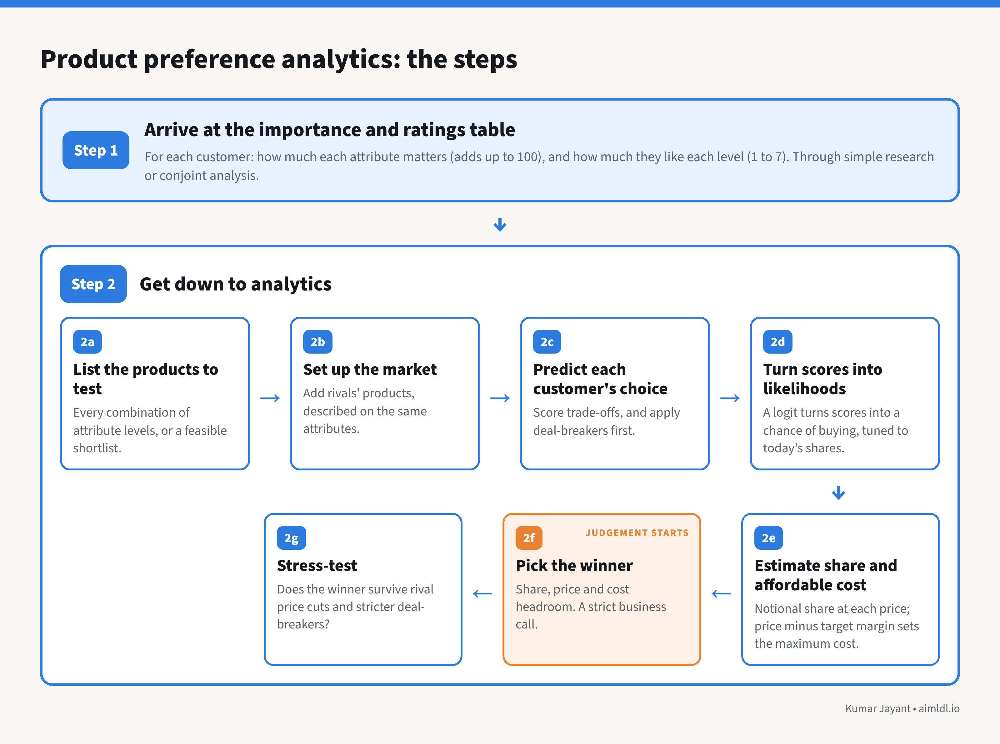
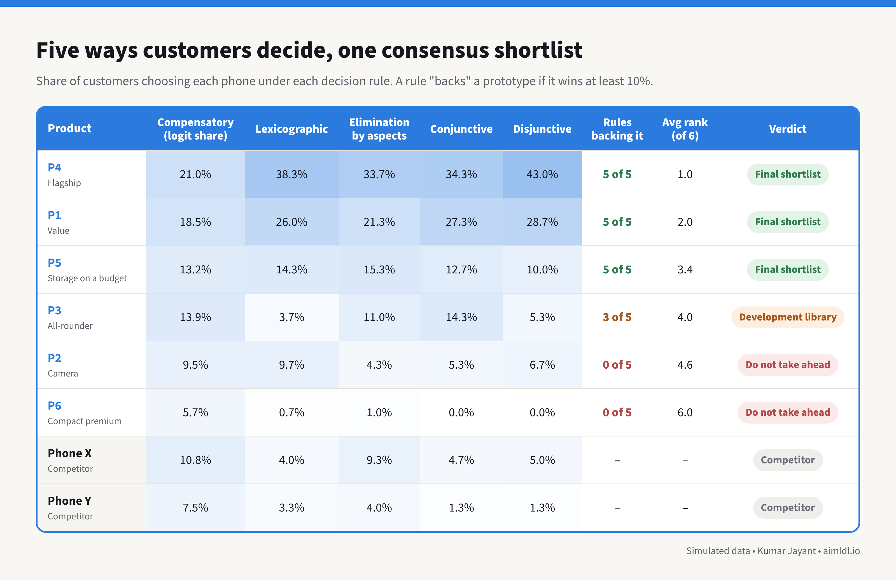
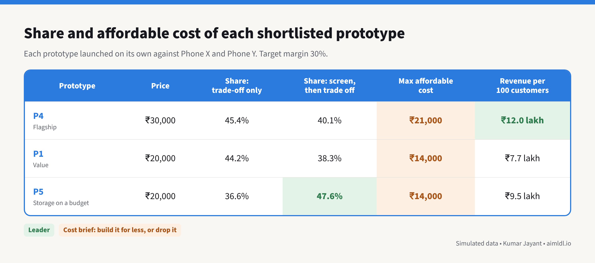

# Drive Out Subjectivity, Build What Customers Value

**The algorithmic way to new offer development.** Companion code and data for the aimldl.io post.

**Blog:** **Blog:** [Drive Out Subjectivity, Build What Customers Value](https://aimldl.io/2026/11/17/drive-out-subjectivity-build-what-customers-value/)  
**Kaggle notebook:** Build What Customers Value: Pick the Winner](https://www.kaggle.com/code/krjynt/build-what-customers-value-pick-the-winner)
**Dataset on Kaggle:** [jPhone: Customer Preferences for New Products](https://www.kaggle.com/datasets/krjynt/jphone-customer-preferences-for-new-products)

---

## What this does

A fictional phone maker, **jPhone**, has six prototypes and two rival phones on the market. Using each customer's importance scores and ratings, the notebook predicts which phone each customer would choose, and which prototypes deserve to be launched.

1. **Step 1:** the importance and ratings table (already in the data).
2. **Step 2a:** list the products to test.
3. **Step 2b:** set up the market, with the rival phones.
4. **Step 2c:** predict each customer's choice under five decision rules: compensatory (weighted additive), lexicographic, elimination by aspects, conjunctive and disjunctive.
5. **Step 2d:** turn scores into likelihoods with a logit model.
6. **Step 2e:** estimate share and the most each shortlisted prototype can cost to make.

## What it finds

- **P4 (flagship), P1 (value) and P5 (storage on a budget)** hold up across the decision rules and make the shortlist.
- Launched on its own, **P5 wins the most customers; P4 earns the most money.**
- **P2 and P6** (top camera, 1-day battery) are backed by none of the rules.

## Files

| File | What it is |
|---|---|
| `new_product_preference_analytics.ipynb` | The full analysis, Steps 1 to 2e |
| `data/jphone_customer_preferences.csv` | 300 simulated customers: segment, importance, ratings, decision rule, deal-breakers |
| `data/jphone_prototypes.csv` | The six jPhone prototypes |
| `data/competitors.csv` | The two rival phones |
| `data/data_dictionary.csv` | Every column explained |
| `data/simulate_jphone_data.py` | The script that generated the data (seed 42) |
| `charts/` | Graphics used in the blog |

## Run it

- **On Kaggle:** open the Kaggle notebook and run all; the dataset is attached.
- **Locally or in Colab:** the notebook finds the data on Kaggle, or downloads it with `kagglehub`. Python 3 with pandas, numpy and matplotlib.
- **Assumptions** (logit sensitivity, target margin, thresholds) are all in the **Settings** cell near the top. Change them there and run all.

## On your own data

One row per customer, importances that add up to 100, a 1 to 7 rating for every attribute level, and (optionally) a decision rule with deal-breakers. Describe your products and the competition on the same attributes, update the Settings cell, and run all.

> The data is fully simulated. It illustrates the method; it is not evidence about the phone market.

### Companion notebook and blog

- **Blog:** [Drive Out Subjectivity, Build What Customers Value](https://aimldl.io/2026/11/17/drive-out-subjectivity-build-what-customers-value/)
- **Notebook:** [Build What Customers Value: Pick the Winner](https://www.kaggle.com/code/krjynt/build-what-customers-value-pick-the-winner)
- **Code on GitHub:** [new-product-preference-analytics](https://github.com/remixwithkj/AIMLDL/tree/main/new-product-preference-analytics)

---

Kumar Jayant · [aimldl.io](https://aimldl.io)
